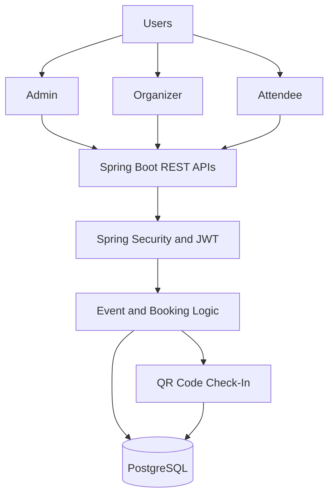

# 🎟️ Event Shaper — Event Ticketing Platform

**Event Shaper** is a backend-driven event management and ticketing platform built with Java and Spring Boot. It enables organizers to manage events, attendees to explore and book events, and administrators to oversee platform operations.

The platform provides REST APIs for event management, role-based access control, ticket booking, and QR-code-based check-in, demonstrating practical backend development using Spring Boot and PostgreSQL.

## ✨ Features

- 👤 **Role-Based Access Control:** Separate access for Admins, Organizers, and Attendees.
- 🎪 **Event Management:** Create, update, manage, and organize events.
- 🎟️ **Ticket Booking:** Support ticket booking workflows through REST APIs.
- 📱 **QR Code Check-In:** Enable ticket verification and attendee check-in using QR codes.
- 🔐 **JWT Authentication:** Secure API access using JSON Web Tokens.
- 🛡️ **Spring Security:** Protect endpoints and enforce role-based authorization.
- 🔗 **RESTful APIs:** Expose 15+ REST API endpoints for application functionality.
- 🗄️ **Database Integration:** Store and manage application data using PostgreSQL.
- ⚙️ **Persistence Layer:** Use Spring Data JPA and Hibernate for database operations.

## 🛠️ Technology Stack

| Technology | Purpose |
|---|---|
| Java | Core programming language |
| Spring Boot | Backend application development |
| Spring Web | Building RESTful APIs |
| Spring Security | Authentication and authorization |
| JWT | Token-based authentication |
| Spring Data JPA | Database access and persistence |
| Hibernate | Object-relational mapping (ORM) |
| PostgreSQL | Relational database |
| Maven | Dependency management and project builds |
| Postman | API testing and validation |
| Git & GitHub | Version control and source code management |

## 🏗️ System Architecture

The application organizes functionality around three primary user roles: Admin, Organizer, and Attendee.



### How It Works

1. **Authentication:** Users authenticate and obtain a JWT when the configured authentication flow succeeds.
2. **Authorization:** Spring Security checks whether the user has permission to access a protected endpoint.
3. **Event Management:** Organizers manage event information through REST APIs.
4. **Ticket Booking:** Attendees interact with the booking functionality to reserve tickets.
5. **QR Code Check-In:** The check-in workflow uses QR codes to identify tickets and verify attendee entry.
6. **Data Persistence:** PostgreSQL stores the application's persistent data through JPA and Hibernate.

## 👥 User Roles

### 1. Admin

- Oversees platform operations.
- Manages platform-level resources according to assigned permissions.
- Accesses administrative endpoints.

### 2. Organizer

- Creates and manages events.
- Maintains event details.
- Manages event-related operations.

### 3. Attendee

- Accesses event information.
- Uses the ticket booking functionality.
- Presents a ticket QR code for check-in where supported.

## 🔐 Security

Event Shaper uses Spring Security and JWT to protect backend APIs.

- **Authentication:** Identifies users through the configured login flow.
- **Authorization:** Restricts protected operations based on user roles.
- **Stateless API Security:** JWT-based authentication can allow requests to be authenticated without relying on a server-side HTTP session.
- **Protected Endpoints:** Limits access to resources according to security configuration.

Ticket QR codes should also be validated on the backend. A production implementation should prevent forged tickets and duplicate check-ins through server-side verification.

## ⚙️ Getting Started

### Prerequisites

Install the following tools:

- Java Development Kit (JDK) compatible with the project
- IntelliJ IDEA or Eclipse
- PostgreSQL
- Maven
- Postman (recommended for API testing)

### 1. Clone the Repository

```bash
git clone https://github.com/Toofail-ahmad/Zentro.git
cd Zentro
```

### 2. Configure PostgreSQL

Create a PostgreSQL database for the application.

```sql
CREATE DATABASE event_shaper;
```

Configure the datasource in `src/main/resources/application.properties` or `application.yml`, according to your project setup.

Example configuration:

```properties
spring.datasource.url=jdbc:postgresql://localhost:5432/event_shaper
spring.datasource.username=${DB_USERNAME}
spring.datasource.password=${DB_PASSWORD}
```

Adjust the database name and environment variables to match your local configuration. Avoid committing database passwords or JWT secrets to GitHub.

### 3. Build the Project

```bash
mvn clean install
```

### 4. Run the Application

```bash
mvn spring-boot:run
```

Alternatively, run the Spring Boot main class from IntelliJ IDEA or Eclipse.

### 5. Test the APIs

Open Postman and send requests to the application's configured base URL.

For protected endpoints, include the JWT in the request header:

```http
Authorization: Bearer <your-jwt-token>
```

Use the actual controller mappings and security configuration to determine the available endpoints and required request bodies.

## 🧪 Testing Checklist

- [ ] Register or authenticate a user using the supported flow.
- [ ] Verify JWT authentication for protected endpoints.
- [ ] Test role-based access for Admin, Organizer, and Attendee.
- [ ] Create and update an event as an authorized organizer.
- [ ] Test the ticket booking workflow.
- [ ] Verify QR-code ticket validation.
- [ ] Test invalid or expired authentication tokens.
- [ ] Confirm that unauthorized users cannot access restricted endpoints.

## 🔮 Future Improvements

- Online payment gateway integration.
- Email notifications and booking confirmations.
- Ticket cancellation and refund management.
- Event search, filtering, and pagination.
- Prevention of duplicate bookings and repeated check-ins.
- Automated unit and integration tests.
- Docker-based deployment and CI/CD automation.
- Event analytics and organizer dashboards.

## 🎯 Project Highlights

- Developed **15+ REST API endpoints** for event management and ticketing functionality.
- Implemented authentication and role-based authorization using Spring Security and JWT.
- Integrated PostgreSQL with Spring Data JPA and Hibernate.
- Designed workflows for Admin, Organizer, and Attendee roles.
- Incorporated QR-code-based ticket check-in functionality.

## 👨‍💻 Author

**Tufail Ahmad**

GitHub: [Toofail-ahmad](https://github.com/Toofail-ahmad)

## 📄 License

Add a `LICENSE` file if you intend to distribute the project under an open-source license.

---

**Event Shaper — Simplifying event management and ticketing through secure REST APIs.**
